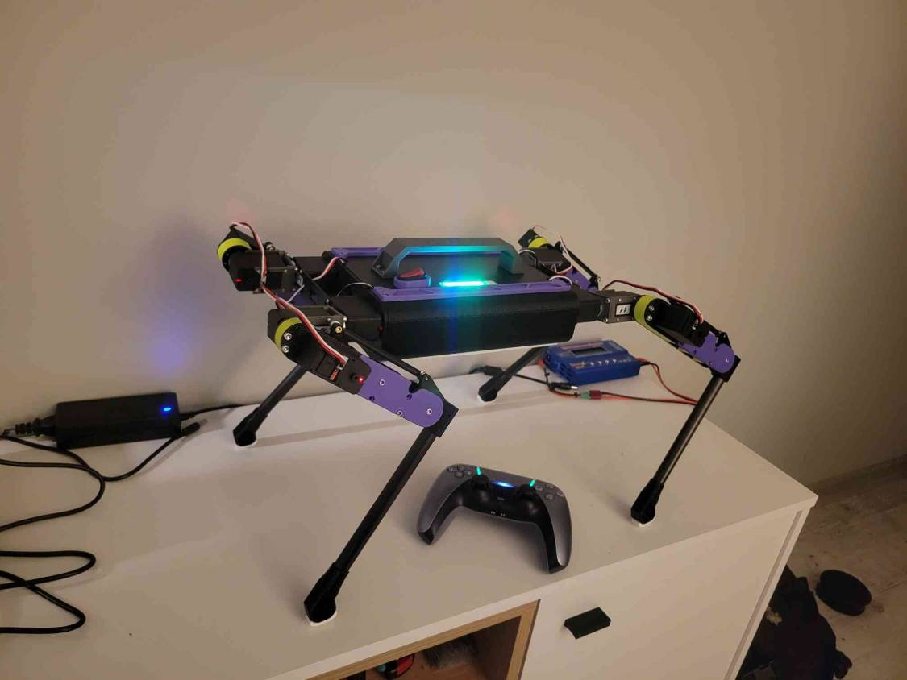

# Aura

A 12-DoF quadruped robot built around twelve Waveshare ST3215 serial bus servos, a custom ESP32 board and a native macOS app. You drive it with a DualSense controller; the app monitors and configures it over Wi-Fi.



<!-- Video: add the demo link here. -->

## Hardware

| Part | Details |
|---|---|
| Controller board | Aura MainBoard: ESP32-WROOM-32E-N8, dual core at 240 MHz, 8 MB flash |
| Actuators | 12 × Waveshare ST3215 serial bus servos, three per leg (ab/ad, hip, knee): 12 V, 30 kg·cm, TTL half-duplex bus at 1 Mbit/s, 12-bit magnetic encoder, position/load/voltage/temperature feedback |
| Battery | 3S3P Li-ion pack, 9 × Panasonic NCR18650BD (three in parallel per series group): 12.6 V full, 10.8 V nominal, 9.3 Ah, about 100 Wh |
| IMU | MPU6050, sampled at 100 Hz |
| Power monitor | INA226 on the servo supply (voltage, current, energy); VIN divider as a fallback |
| Distance | VL53L4CD time-of-flight port (optional) |
| Status LEDs | 8 × WS2812: robot state, selected mode, six-segment battery bar |
| Controller | Sony DualSense over Bluetooth Classic; the ESP32 is the HID host |

Aura refuses to arm at 10.0 V or below. Wi-Fi and Bluetooth start only when a stable supply above 7 V is present, so the board can be programmed over USB with the servos unpowered. Pin assignments and the full board reference are in [docs/mainboard.md](docs/mainboard.md).

## Driving with the DualSense

Press PS on a paired controller to connect. A new controller is paired from the app's Controller page.

| Input | Action |
|---|---|
| Create | Arm / disarm |
| D-pad → / ← | Next / previous mode (ignored while walking) |
| D-pad ↑ / ↓ | Body height ±30 mm, within 120–250 mm |
| Left stick | Mode 2: tilt the body. Modes 3–4: walk forward and sideways |
| Right stick X | Modes 3–4: turn |
| L1 | Mode 3: spin in place |
| × | Jump |
| Options | Three-leg test |

| Mode | Behaviour |
|---:|---|
| 1 | **Balance.** Stands still; the IMU keeps the body level against a stored level calibration. |
| 2 | **Body pose.** The left stick tilts the body up to ±15° in roll and pitch. |
| 3 | **Walk.** Trot with the saved Run profile. |
| 4 | **Balanced trot** (experimental). Saved Trot profile with a planned body trajectory. |
| 5 | **Stand.** |

Stride, step height, frequency and duty factor of modes 3 and 4 are edited in the app and stored on the robot. The pad's player LEDs and LED 2 of the strip show the selected mode. The lightbar shows the robot state: orange when disarmed, green when armed, red during a calibration test, and blinking red for a latched fault.

## Aura app (macOS)

A native SwiftUI app that finds the robot with Bonjour (`aura-main-board.local:4242`) and receives telemetry at 10 Hz. It never sends motion targets; the robot runs every control loop itself.

| Group | Pages |
|---|---|
| Monitor | **Overview**, **Charts** (power, IMU, joints), **Route** (3D path from the on-board estimator), **Sessions**, **Robot 3D** |
| Robot | **Configuration** (gait profiles, motion tuning), **Calibration** (zero, direction and limits per leg), **IK Test** (offline preview of pad modes 1–4 with the robot's own planner), **Servos** (scan, IDs, direct control) |
| Board | **IMU** (attitude, level calibration), **Controller** (pairing, live DualSense state), **Sensors**, **LED**, **Firmware** (build and flash, board health) |

- **Sessions:** every run is logged on the Mac only, in `~/Documents/Aura/Sessions`. Each log holds per-mode statistics, events (arming, mode changes, faults, restarts) and a 25 Hz trace of the joints, IMU and sticks.
- **Board health:** CPU load per core, task loop rates, free stack and heap, and the last crash the robot stored.

## Firmware

ESP-IDF 6.1, written in C. The ESP32 runs these loops:

- **Gait, 50 Hz:** pad input and mode, foot and body trajectories, inverse kinematics, then a joint trajectory limiter that respects the servos' finite speed.
- **Servo control, 50 Hz:** one synchronous write to all twelve servos. Feedback reads one servo every 5 ms.
- **State estimator:** an 18-state Kalman filter that fuses the IMU with leg kinematics. It estimates position, velocity, heading and ground height.
- **Telemetry, 10 Hz:** one TCP write per cycle to the app.

Bluetooth runs on core 0. Gait, servo control, servo feedback and the estimator are pinned to core 1.

Safety rules in the firmware:

- Torque stays off until a complete, calibrated 12-axis map is loaded and the robot is armed.
- A stalled joint releases every servo.
- A low battery blocks arming.
- The last crash is kept in a core dump partition and reported to the app after the restart.

Design notes:

- [Locomotion model](docs/locomotion-model.md)
- [Robot control](docs/robot-control.md)
- [Kinematics review](docs/kinematics-review.md)
- [Gait balance (Polish)](docs/balans-chodu.md)
- [References](docs/references.md), including MIT Cheetah 3

## Build and flash

**Prerequisites.** ESP-IDF 6.1 and Xcode command line tools. Copy `main/wifi_credentials.example.h` to `main/wifi_credentials.h` and fill in your network; the copy is ignored by git.

**Firmware.** Connect the board over USB and run:

```sh
tools/flash_firmware.sh
```

The script does four things:

1. Backs up the settings partition (NVS).
2. Builds the firmware.
3. Flashes it **without erasing NVS**.
4. Checks that NVS is unchanged.

The app's Firmware page runs the same script. NVS holds the servo calibration, gait profiles, level calibration and controller pairing, so never run `erase-flash` on a configured robot.

**App:**

```sh
desktop/MainBoardControl/build.sh   # -> desktop/MainBoardControl/dist/Aura.app
```

**Host tests.** These are C tests for kinematics, gait, balance, the estimator and the protocols:

```sh
tools/run_host_tests.sh
```

## Repository layout

| Path | Contents |
|---|---|
| `main/` | ESP-IDF firmware: drivers (servos, IMU, INA226, VL53L4CD, WS2812), radio (Wi-Fi + DualSense HID), kinematics, gait, balance, estimator |
| `desktop/MainBoardControl/` | macOS app (SwiftUI) |
| `tests/` | Host tests (C) |
| `tools/` | Flashing, NVS backup and restore, test runner |
| `gazebo/` | SDF model and controller for Gazebo |
| `docs/` | Board reference, protocols, locomotion model, schematic, bring-up notes |
| `docs/datasheets/`, `docs/hardware/` | Datasheets (ICM-42688, INA226, ST/SCS servo library), ST3215 3D model |
| `diagnostics/` | Standalone test programs (ICM-42688, DualSense) |
